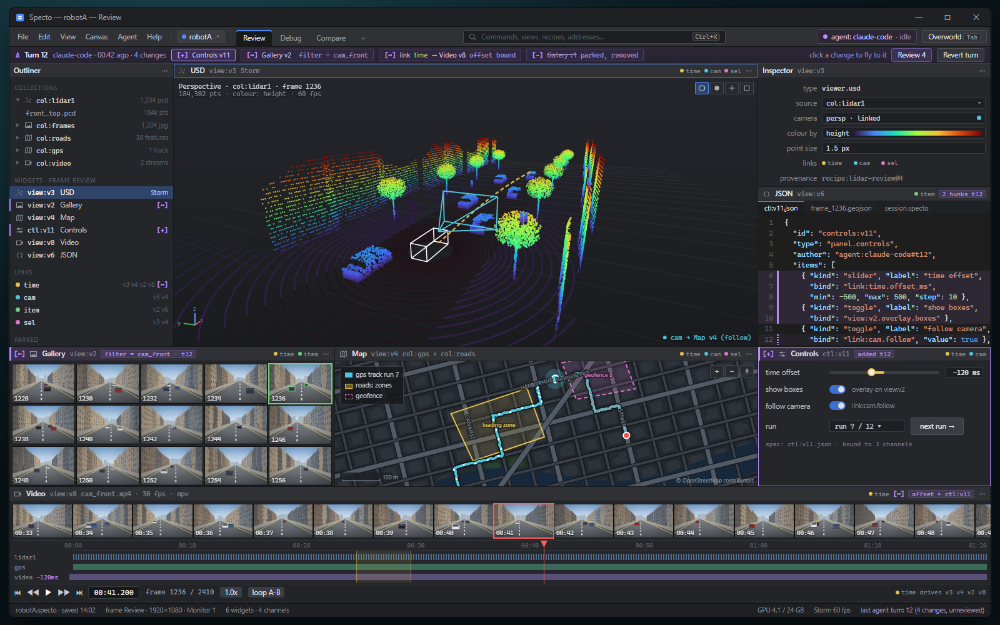
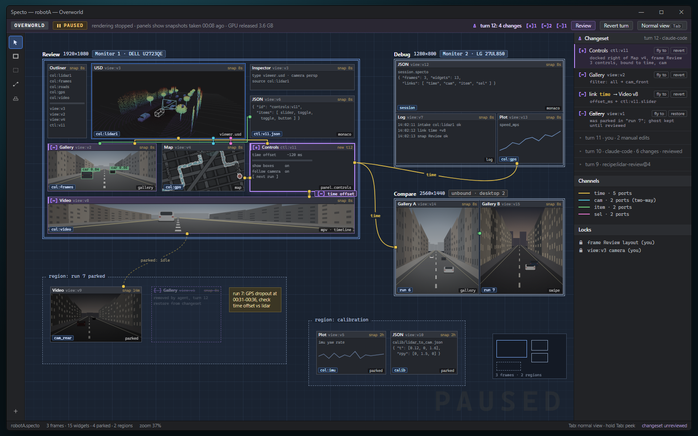
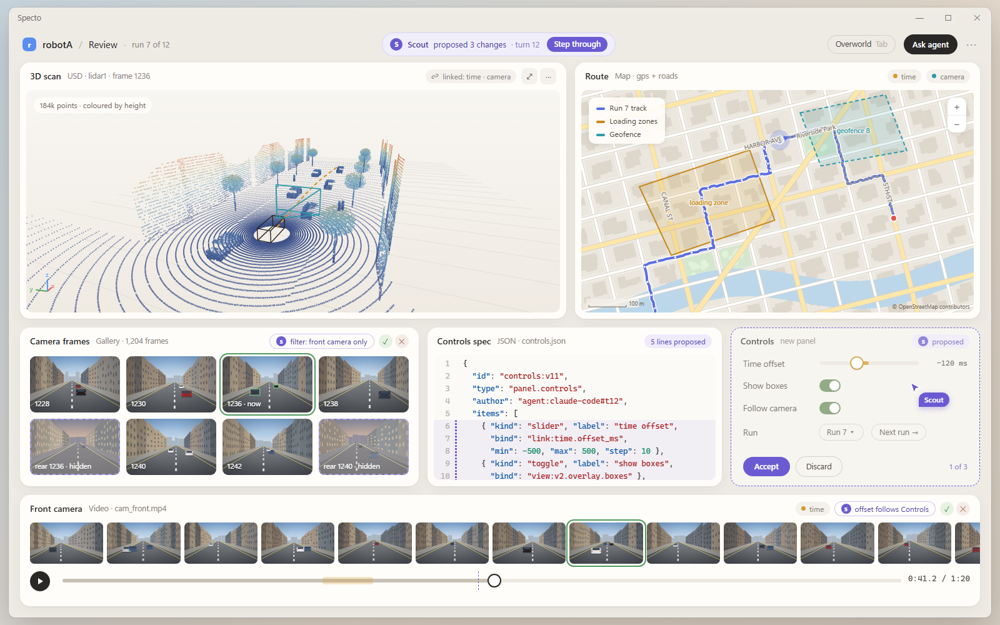
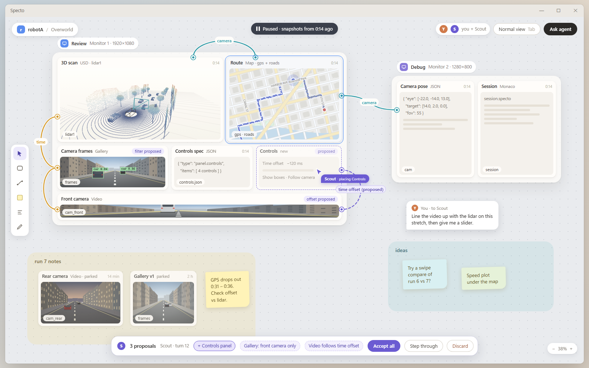
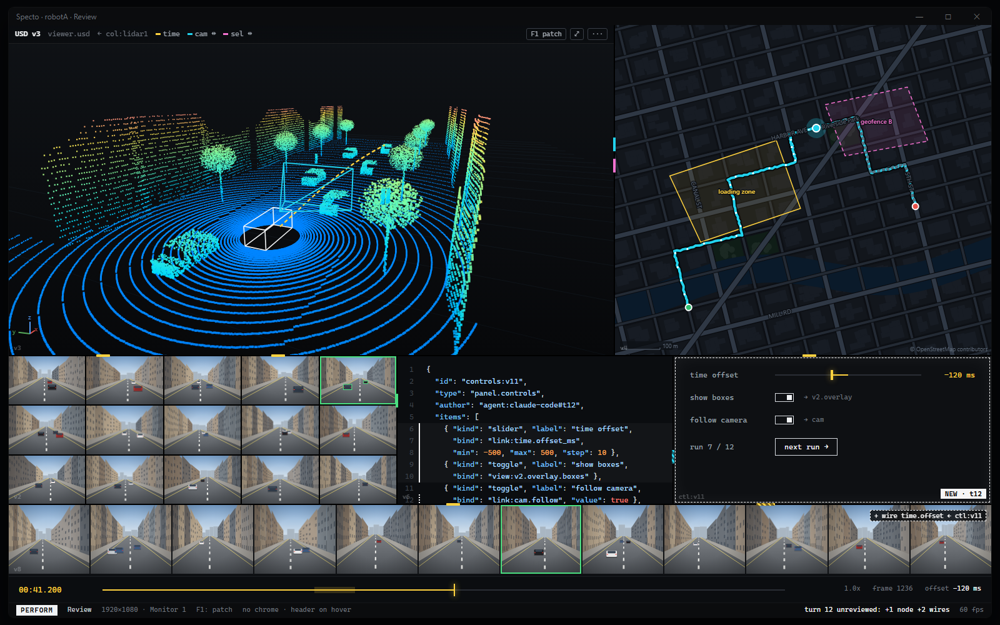
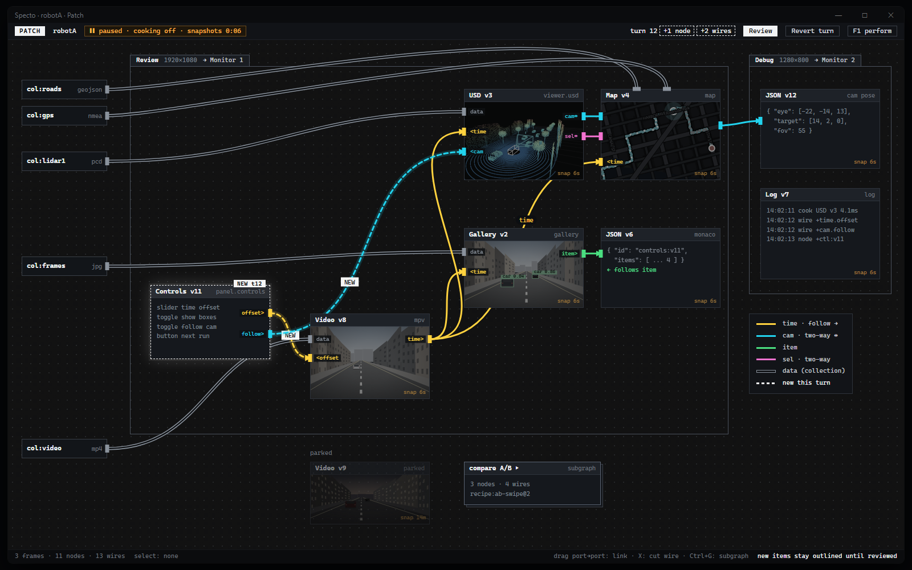
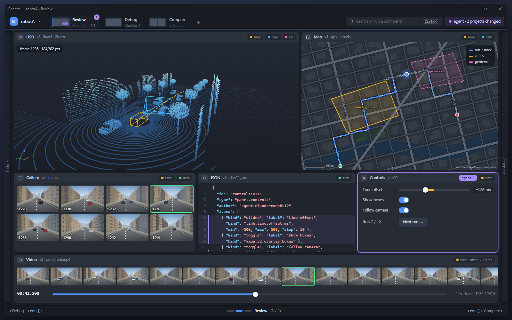
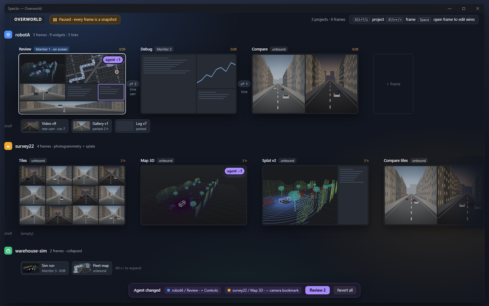

# GUI style directions for Specto (review draft, 2026-10-12)

**TLDR**

- Surveyed ~35 apps in five groups: overview canvases, docked pro tools, node editors,
  data viewers, and generative/agent-composed UI. Lessons per group below.
- The closest analogues to normal view + overworld are TouchDesigner (network editor
  vs Perform Mode) and Max (patching vs presentation mode). Both are proven and modal.
- Generative UI in 2025-2026 split into two camps: the agent picks from a fixed
  component catalogue (A2UI, AG-UI "controlled" UI), or the agent writes sandboxed HTML
  (MCP Apps, Claude artifacts, tldraw Make Real). Specto's compose and custom-view
  tiers already map onto both camps.
- What almost all of them get wrong: the UI lives in a chat stream, gets regenerated
  whole, and has no diff, review step or protection for user edits. Specto's
  per-turn transaction plus highlighting is the gap they leave open.
- Four directions: **A Studio** (dense dark pro tool), **B Calm Canvas** (whiteboard
  overworld, agent changes as proposals), **C Patch/Perform** (wires first, TouchDesigner
  style), **D Desk Strip** (frames on a scrolling strip, niri/Stage Manager style).
- My recommendation: start from **A**, take typed wires from **C** and the proposal
  mode from **B**. Questions for you are inline.

Mockup images are illustrative renders, not real screenshots.

## 1. What the survey says

### Overview / zoomable workspaces

| App | Take | Avoid |
|---|---|---|
| Figma | Frames as the unit of layout; the canvas agent (beta, May 2026, per secondary sources) is aimed at selected frames, and several agents can run at once | Free zoom at every level; Specto has just two levels on purpose |
| tldraw (Make Real, tldraw computer, "Fairy" agents) | Generated apps *stay on the canvas*, and you annotate them to drive the next turn; agents are visible on the canvas, not hidden in a sidebar | Sketch-like styling reads as a toy for data work |
| Obsidian Canvas / JSON Canvas | Plain, diffable file format for nodes and edges; cards embed real files | Edges carry no meaning |
| Heptabase | Two-level map (map, then whiteboards), with explicit advice not to nest deeper; one card can sit on several boards | |
| Muse | Nested boards, calm and chrome-light, very fast | |
| Miro (Sidekicks, Flows) | Select content on the board to give the agent context; agents act "like a team member" on the board | Busy chrome, everything shown at once |
| Excalidraw | Minimal toolbar, nothing on screen until needed | |
| macOS Mission Control / Exposé / Stage Manager | One key reveals every window at once; Stage Manager keeps a side strip of parked apps | Exposé thumbnails lose identity at small scale: always label them |
| niri / PaperWM | Windows sit in columns on an endless horizontal strip, and opening one never resizes the others; workspaces stack vertically; niri 25.05 added an overview zoom | Strip order, not 2D position, is the only spatial cue |
| Arc / Zen spaces | One colour and icon per space makes project switching instant to read | Arc's own team stopped feature work in May 2025, citing low retention and too little cohesion |

### Docked pro tools

| App | Take | Avoid |
|---|---|---|
| Blender | Workspaces as tabs over one data model; split and join areas by dragging corners; any area can switch editor type | Hover decides which area gets the keystroke: powerful but opaque to newcomers |
| Unreal Editor | Named, saved layouts; Details/Outliner as the shared vocabulary | Too many nested tab wells |
| Omniverse Kit | Layouts saved as data (`omni.ui.Workspace`), extensions contribute windows | |
| Houdini | Network editor with network boxes, sticky notes and colour as organisation; pane tabs can be torn off into floating windows | |
| VS Code / Zed / JetBrains | Command palette as the universal entry point; Zed's agent panel reviews edits as a multi-file diff with accept/reject per hunk; JetBrains tool-window stripes | Sidebar sprawl |
| DaVinci Resolve | Fixed "pages" (Cut, Edit, Fusion, Color, Fairlight, Deliver) across the bottom: one click switches the whole layout | Pages are fixed by the vendor, which is the opposite of agentic |

### Node / link visualisation

- **TouchDesigner**: Perform Mode renders only one chosen Window COMP; the network
  editor closes; F1 and Esc toggle between the two modes. This is overworld/normal almost exactly,
  including "pause the editor to save the cost".
- **Max/MSP**: each object has *two* positions, one in the patching layout and one in the
  presentation layout; the toolbar toggle turns green and the title bar shows
  "(presentation)". It proves two layouts of one graph can work, and shows the cost: two
  layouts to keep tidy.
- **ComfyUI**: subgraphs collapse nodes into one node you can open like a folder;
  App Mode (March 2026) hides the graph and shows only chosen inputs and outputs.
  Same split again: a builder view and a user view.
- **Unreal Blueprints / Houdini**: wires and pins coloured by type; reroute nodes;
  comment boxes. Type colour is the main reading aid at overview zoom.

### Data viewers

- **Rerun**: the layout ("blueprint") is a tree of Horizontal/Vertical/Grid/Tabs
  containers, shown in its own panel; reset goes to the default from code *or* to a
  layout guessed from the data. That is a clean model of "layout as data".
- **Foxglove / Lichtblick**: grid of split panels with per-panel settings in a side
  drawer, named layouts, and a visible "unsaved changes" marker on the layout.

### Generative and agent-composed UI (2025-2026)

| System | Model | Gets right | Gets wrong (for Specto's purpose) |
|---|---|---|---|
| Google A2UI (exists: Apache-2.0, v0.9.1 current, v1.0 candidate) | Agent streams flat declarative JSON; client renders only components in an approved catalogue | Safe like data, native widgets, incremental build | No layout persistence or review story; the UI is a message |
| CopilotKit AG-UI | Event protocol over Server-Sent Events (SSE) between agent and app; "controlled" UI = pre-built components the agent picks | Shared state, tool calls and UI in one event stream | Chat-centred |
| MCP Apps (SEP-1865; Anthropic, OpenAI and MCP-UI authors) | Tools point at `ui://` HTML templates rendered in sandboxed iframes; JSON-RPC (remote procedure call) over `postMessage` | Templates are pre-declared and reviewable; UI-initiated tool calls need user consent | Each app is an island inside a chat turn |
| OpenAI Apps SDK | Inline, fullscreen and picture-in-picture display modes | "Use rich UI only when it helps the workflow"; picture-in-picture keeps a widget alive across turns | Host owns the frame; the app cannot arrange anything |
| Vercel AI SDK generative UI, v0 | Tool results rendered as React components; v0 generates whole apps | Typed tool-to-component mapping | AI SDK RSC (React Server Components) streaming is paused; v0 regenerates rather than patches |
| Claude artifacts | Agent writes a whole HTML page, user iterates by prompt | Fast, sandboxed, versioned | Edits by hand and by agent do not merge; versions replace each other |
| Thesys C1 | LLM API that returns UI specs instead of text | Design-system-aware output | Vendor claims only; whole-response regeneration |
| tldraw agents, Figma agent, Miro Sidekicks | Agent edits a persistent shared canvas | Same surface for agent and user; select-to-scope | Review is "look at it and undo", no per-change accept |

Three lessons carry over:

1. **Catalogue first, code second.** A2UI and AG-UI show that a fixed, self-described
   vocabulary is what makes agent UI safe and consistent. Specto's compose tier is this.
   Styling must be part of the catalogue too: agents pick tokens and densities, they never
   invent colours.
2. **Persistence plus patching beats regeneration.** Every chat-bound system loses user
   edits on the next generation. Specto's session document and patch semantics are the fix,
   but only if the UI *shows* what was patched.
3. **Review needs a unit and a verb.** Coding agents (Zed, Cursor, Claude Code) settled on
   "a changeset, per-hunk accept/reject". No canvas product has that yet. Specto can.

## 2. Style directions

### Direction A: Studio (pro tool, dark, dense)

The normal view is a Blender/Houdini/Kit-grade dark docked app: outliner, viewport,
inspector, timeline. The overworld is a blueprint-style schematic of frames with small
panels, ports and wires. Agent changes apply at once and are marked with diff glyphs;
review is a changeset bar.

Borrows from: Blender, Houdini, Omniverse Kit, Unreal, Rerun, Zed's review panel.

```text
+-[robotA v]-[Review]-[Debug]-------------- Ctrl+K   agent: idle --+
| Outliner      | USD v3 (Storm)              | Inspector  view:v3   |
| > col:lidar1  |                             |  camera  persp       |
| > col:frames  |         [ live 3D ]         |  links   time, cam   |
| > col:roads   |                             |  source  col:lidar1  |
|---------------+-------------------+---------+----------------------|
| Gallery v2 [~]| Map v4            | Controls [+]                   |
| [][][][][]    |   . . track . .   |  t-offset  ----o---            |
| [][][][][]    |                   |  [ next run ]                  |
+---------------+-------------------+--------------------------------+
| time  |------o---------------------------------| 00:41.200   1.0x  |
+-------------------------------------------------------------------+
  [+] added by agent this turn    [~] changed by agent this turn
```

```text
+- OVERWORLD  paused --- turn 12: 3 changes  [Review] [Revert turn] -+
|                                                                    |
|  +== Review  1920x1080  Monitor 1 ==+   +== Debug  1280x800 ==+    |
|  | Outliner | USD v3   o<-cam-+    |   | Monaco    | JSON     |    |
|  |----------+---------------- |    |   |-----------+----------|    |
|  | Gallery~ | Map v4   o<-cam-+    |   | Log       |          |    |
|  | Ctrl+  o-+--time------------>o  |   +======================+    |
|  +==================================+                              |
|                                                                    |
|  [ region: run 7 parked ]                                          |
|   Video v9  o        - Gallery v1 (removed, ghosted)               |
+--------------------------------------------------------------------+
```



*Docked dark studio: outliner, Storm viewport, inspector and JSON on top; gallery, map and the agent-built controls below; turn-12 changeset bar under the toolbar.*



*Blueprint schematic, paused: double-rule frames bound to monitors, panels with ports, channel-coloured wires routed in gutters, parked regions and the changeset list.*

- **Visual language**: dark neutral grey (not pure black), one accent for focus and one
  agent hue; 11-12 px UI text, monospace for addresses (`view:v3`); 1 px separators,
  no shadows; icons monochrome.
- **Agent changes**: glyph plus colour on the panel header (`+` added, `~` changed, `-`
  removed and ghosted in the overworld). The changeset bar lists each change; click one
  to fly to it; revert per change or per turn.
- **Wires and frames**: thin wires coloured by channel type, drawn only in the
  overworld; frames as heavy double-rule rectangles labelled with size and the monitor
  they are bound to.
- **Strengths**: matches the tools you already live in; dense enough for 3D, map, video
  and code at once; the easiest to build in Qt Quick.
- **Risks**: looks like every DCC (digital content creation) tool, so the "agentic"
  idea may not read; the overworld schematic can get cramped at many frames.

### Direction B: Calm Canvas (whiteboard overworld, proposals)

The overworld is a quiet, light whiteboard (tldraw, Heptabase, Muse): frames are
cards, regions are soft labelled areas, and the agent appears as a named cursor that
moves while it works. Agent turns land as *proposals*, ghosted until you accept, like
"suggesting" mode in a document editor. The normal view stays a docked app, but a calmer one.

Borrows from: tldraw (Make Real, Fairy agents), Heptabase, Muse, Miro Sidekicks,
Figma frames, Excalidraw's empty chrome.

```text
 robotA  .  Review                                  [ Ask agent ]  ...
 ------------------------------------------------------------------
 |                                 |                              |
 |     USD v3                      |   Map v4                     |
 |                                 |                              |
 |        ( live 3D )              |      ( track )               |
 |                                 |                              |
 ------------------------------------------------------------------
 |  Gallery v2                     |  Controls  (proposed)        |
 |  ::  ::  ::  ::  ::             |  t-offset  ----o---          |
 |                                 |  [ Accept ]  [ Discard ]     |
 ------------------------------------------------------------------
   0:41.2  ------o----------------------------------------------
```

```text
   .  .  .  .  .  .  .  .  .  .  .  .  .  .  .  .  .  .  .  .  .
   .  ( Review )                          ( Debug )          .
   .  .----------------------.           .---------------.    .
   .  | USD v3    | Map v4   |~~~cam~~~~ | Monaco | JSON |    .
   .  |-----------+----------|           '---------------'    .
   .  | Gallery   | Controls |  <- dashed: proposed            .
   .  '----------------------'                                .
   .         \__ time __/          >  agent "Scout" is here   .
   .                                                          .
   .  ~ run 7 notes ~   [ Video v9 ]   [ Gallery v1 ]         .
   .                                                          .
   .   3 proposals   [ Accept all ]  [ Step through ]  [ Discard ]
```



*Calm docked view: rounded cards, links as quiet pills, Scout's three proposals shown dashed with accept and discard in place.*



*Whiteboard overworld, paused: window cards with name pills, soft labelled wires, a proposed panel and wire, Scout's cursor, a user note to the agent and the proposal bar.*

- **Visual language**: light or warm-grey background, generous padding, 13-14 px text,
  rounded cards with soft shadow, almost no chrome until you hover. Dark theme exists
  but is not the identity.
- **Agent changes**: proposals render dashed and translucent; the agent cursor carries
  its session name; "Step through" walks proposals one by one with the camera.
- **Wires and frames**: soft curved wires with a channel label at the midpoint; frames as
  cards with the window name in a pill above them.
- **Strengths**: makes the agent visible and the review step explicit; friendly for
  sharing screenshots; proposals protect your edits by default.
- **Risks**: proposal mode adds a second state (applied vs proposed) to every command and
  to `snap`; light styling fights dark 3D and video content; lower density.

### Direction C: Patch / Perform (wires first)

The overworld *is* a patch: every widget is a node with typed ports on its edges, wires
are first-class and colour-coded, and frames are "presentations" of those nodes, like
TouchDesigner Window COMPs or Max presentation mode. The normal view is Perform Mode:
near chromeless, one key away.

Borrows from: TouchDesigner, Max/MSP, ComfyUI App Mode and subgraphs, Unreal Blueprints,
Houdini network boxes.

```text
+-------------------------------------------------------------------+
|                                    |                              |
|   USD v3                           |   Map v4                     |
|                                    |                              |
|                                    |                              |
|------------------------------------+------------------------------|
|   Gallery v2                       |   t-offset  ----o---         |
|                                    |   [ next run ]               |
+-------------------------------------------------------------------+
 PERFORM  Review   F1: patch   (no other chrome; header on hover)
```

```text
 PATCH  robotA                     turn 12: +1 node  +2 wires  [Review]
  .-- Review 1920x1080 ---------------------------------------.
  | [col:lidar1]=>[ USD v3 ]cam>-----+                         |
  |                  time<           |                         |
  |                   |          cam<[ Map v4 ]<=[col:roads]   |
  |  [col:frames]=>[ Gallery v2 ]item>----------------------+  |
  |                   |                                      | |
  |      +====>[ Controls ]time>....(new, dashed)...........+ |
  '--------------------------------------------------------- -'
   [ Video v9 ]  parked             [ subgraph: compare A/B  > ]
   wire colours:  time = yellow  cam = cyan  item = green  sel = magenta
```



*Perform view: edge-to-edge panels, header only on the hovered panel, link ports as coloured notches, the new node outlined until reviewed.*



*Patch view, paused: collections as source nodes, typed thick wires with direction, frames as labelled outlines, new node and wires dashed, parked node and a subgraph.*

- **Visual language**: dark, mid-density; monospace node labels; colour reserved almost
  entirely for channel types; perform view has no chrome at all.
- **Agent changes**: new nodes and wires flash, then stay outlined until reviewed; the
  turn summary counts nodes and wires separately, because a wrong link is the usual bug.
- **Wires and frames**: thick, type-coloured wires with direction arrows (two-way vs
  follow); collections are source nodes; frames are labelled outlines around nodes.
- **Strengths**: makes Specto's real differentiator, typed channel links between unlike
  views, the visual centre; collapsible subgraphs map well to recipes.
- **Risks**: graph layout and window layout compete. Max solves it with two positions per
  object, which doubles the layout work for you and the agent. Wires inside docked
  frames get busy fast.

### Direction D: Desk Strip (frames on a scrolling strip)

Window frames sit side by side on a horizontal strip per project, projects stack
vertically, and the overworld is an overview zoom of the whole desk (niri, Mission
Control). Parked widgets live in a shelf under each strip (Stage Manager). The normal view
has a page bar of frames, like DaVinci Resolve pages.

Borrows from: niri, PaperWM, macOS Mission Control and Stage Manager, Resolve pages,
Arc/Zen space colours.

```text
+-------------------------------------------------------------------+
| robotA  |  Review  |  Debug  |  Compare  |  +        Ctrl+K  agent |
|-------------------------------------------------------------------|
| USD v3                           | Map v4                         |
|                                  |                                |
|          ( live 3D )             |      ( track )                 |
|                                  |                                |
|----------------------------------+--------------------------------|
| Gallery v2                       | Controls  [agent +]            |
+-------------------------------------------------------------------+
 <  Debug                    Review  (2 / 3)                Compare  >
```

```text
 OVERWORLD                                       Alt+Up/Down: project
 robotA (blue)  ------------------------------------------------------
  [ Review     ]  [ Debug    ]  [ Compare      ]  [ + frame ]
  [ USD | Map  ]  [ Monaco   ]  [ Gal A|Gal B  ]
  [ Gal | Ctl+ ]  [ JSON     ]  [  ~ swipe     ]
  shelf: Video v9   Gallery v1   Log v7
 survey22 (amber)  ---------------------------------------------------
  [ Tiles     ]  [ Map 3D     ]
  [ Gallery   ]  [ Splat v2 ~ ]
  shelf: (empty)
 ---------------------------------------------------------------------
  agent changed: robotA/Review (1), survey22/Map 3D (1)   [Review]
```



*Page bar of frames with agent badge, neighbouring frames peeking at the edges, strip navigator at the bottom.*



*Desk overview, paused: one strip per project with uniform-height frame snapshots, monitor labels, link counts on frame edges, shelves and a cross-project change list.*

- **Visual language**: medium density; each project has a colour and icon; frames are
  uniform thumbnails at the same height; motion carries meaning (scrolling the strip
  equals switching frames).
- **Agent changes**: badges on frame thumbnails and a cross-project change list, which
  suits agents working across several projects at once.
- **Wires and frames**: wires shown only inside a frame zoomed in from the overview; links
  across frames shown as a count on the frame edge.
- **Strengths**: best multi-project and multi-frame overview; strong spatial memory;
  maps cleanly to OS windows and monitors.
- **Risks**: gives up the free 2D canvas in DESIGN.md (regions, arbitrary placement);
  wires become second-class; niri-style rigidity can feel limiting for parked layouts.

## 3. Cross-cutting recommendations

1. **Overworld transition**: one key, tap to toggle and hold to peek (release returns).
   Animate from the focused widget as the zoom anchor in about 200 ms. The paused state
   must be unmistakable: tinted background, "paused" label, snapshot age on each panel.
2. **Agent change review**: per-turn changeset with glyph plus colour (never colour
   alone), fly-to on click, revert per change or per turn, and a "before" ghost of the
   previous layout. The same changeset is what `snap` and `state get` report to the agent.
3. **User override and locks**: pin or lock a widget, group or frame so agents must ask
   before moving it; locks live in the session document so the agent sees them. This is
   the protection chat-bound generative UI lacks.
4. **Command palette** over the command registry: every command, every address
   (`view:v3`), recipes, projects. Later the same box hands a prompt to the agent.
5. **Keyboard model**: identical bindings in both levels where meaning carries over
   (delete, group, dock); explicit focus, not hover focus; every binding is a command,
   so it is rebindable and shown in the palette.
6. **Styling is vocabulary**: theme tokens, density levels and panel accents are in
   `api-info.json`; agents choose from them, never set raw colours (A2UI's catalogue lesson).
7. **Provenance on every panel** in the overworld: made by you, by an agent session, or by
   a recipe, with the turn number.
8. **Empty canvas is not blank**: show recent recipes, a drop target and the palette hint.

## 4. Questions

```ask
id: style
type: choice
question: Which direction should Specto start from?
options:
  - A Studio (pro tool, dark, dense)
  - B Calm Canvas (whiteboard overworld, proposals)
  - C Patch / Perform (wires first)
  - D Desk Strip (frames on a scrolling strip)
  - A hybrid I describe in the text box
```

```ask
id: borrow
type: multi
question: Which elements should be borrowed into the chosen direction?
options:
  - "A: diff glyphs [+] [~] [-] on panel headers"
  - "A: dense outliner / inspector / timeline frame"
  - "B: agent shown as a named cursor on the canvas"
  - "B: proposal mode (agent changes ghosted until accepted)"
  - "B: soft labelled regions for parked widgets"
  - "C: typed, colour-coded ports and wires"
  - "C: chromeless perform-style normal view"
  - "C: collapsible subgraphs that map to recipes"
  - "D: page bar of frames in the normal view"
  - "D: projects as rows with colour and icon"
  - "D: parked-widget shelf per project"
```

```ask
id: crosscut_rank
type: rank
question: Rank the cross-cutting recommendations by priority for the first milestone.
options:
  - Overworld transition (tap/hold, paused state)
  - Agent change review (changeset, revert, before-ghost)
  - User override and locks
  - Command palette
  - Keyboard model
  - Styling as vocabulary (tokens, no raw colours)
  - Provenance on every panel
  - Non-blank empty canvas
```

```ask
id: fit_a
type: rating
question: "Fit of Direction A, Studio (1 = wrong for Specto, 5 = right)"
min: 1
max: 5
```

```ask
id: fit_b
type: rating
question: "Fit of Direction B, Calm Canvas (1 = wrong for Specto, 5 = right)"
min: 1
max: 5
```

```ask
id: fit_c
type: rating
question: "Fit of Direction C, Patch / Perform (1 = wrong for Specto, 5 = right)"
min: 1
max: 5
```

```ask
id: fit_d
type: rating
question: "Fit of Direction D, Desk Strip (1 = wrong for Specto, 5 = right)"
min: 1
max: 5
```

```ask
id: missing
type: text
question: Anything missing, wrong, or a direction you would add?
placeholder: e.g. an app I should have looked at, a hybrid, a constraint
```

## Sources

Verified in this pass (official docs or primary pages):

- https://derivative.ca/UserGuide/Perform_Mode
- https://docs.cycling74.com/legacy/max8/vignettes/presentation_mode
- https://a2ui.org
- https://blog.modelcontextprotocol.io/posts/2025-11-21-mcp-apps/
- https://modelcontextprotocol.io/seps/1865-mcp-apps-interactive-user-interfaces-for-mcp
- https://developers.openai.com/apps-sdk/concepts/ui-guidelines
- https://developers.openai.com/blog/15-lessons-building-chatgpt-apps
- https://github.com/CopilotKit/generative-ui
- https://docs.showcase.copilotkit.ai/agentic-protocols/ag-ui
- https://vercel.com/templates/ai/rsc-genui (AI SDK RSC development paused)
- https://tldraw.dev/use-cases/ai-enabled-canvas
- https://www.ai.engineer/talks/sPUjIBH5Cwg-agents-on-canvas-in-tldraw
- https://wiki.heptabase.com/organize-knowledge-and-projects
- https://miro.com/ai/sidekicks
- https://github.com/niri-wm/niri
- https://lwn.net/Articles/1025866
- https://linuxiac.com/niri-25-05-wayland-compositor-introduces-workspace-overview/
- https://engadget.com/ai/the-browser-company-stops-active-development-of-arc-in-favor-of-new-ai-focused-product-153045276.html
- https://rerun.io/docs/reference/viewer/blueprints
- https://blog.comfy.org/p/subgraph-official-release
- https://museapp.com

Secondary sources only (treat as unverified):

- Figma canvas agent beta, May 2026: https://www.banani.co/blog/figma-agent-review ,
  https://aiweekly.co/alerts/figma-ai-agent-edits-layers-inside-canvas-beta
- ComfyUI App Mode, March 2026: https://www.gigazine.net/gsc_news/en/20260312-comfyui-app-mode
- Thesys C1 (vendor press release): https://secure.businesswire.com/news/home/20250418761213/en/Thesys-Introduces-C1-to-Launch-the-Era-of-Generative-UI
- A2UI v0.8 coverage and production use at Google: https://the-decoder.com/googles-open-standard-lets-ai-agents-build-user-interfaces-on-the-fly/
- MCP Apps "stable 2026-01-26": https://www.morphllm.com/mcp-apps

From memory, not re-checked in this pass: Blender area splitting and workspaces, Unreal
layouts, Omniverse Kit `omni.ui.Workspace`, Houdini network boxes and pane tabs, VS Code,
JetBrains tool windows, Zed's agent review panel, DaVinci Resolve pages, macOS Mission
Control and Stage Manager, Obsidian JSON Canvas, Excalidraw, Foxglove layouts, v0
regeneration behaviour, Claude artifacts versioning, Unreal Blueprint pin colours.
